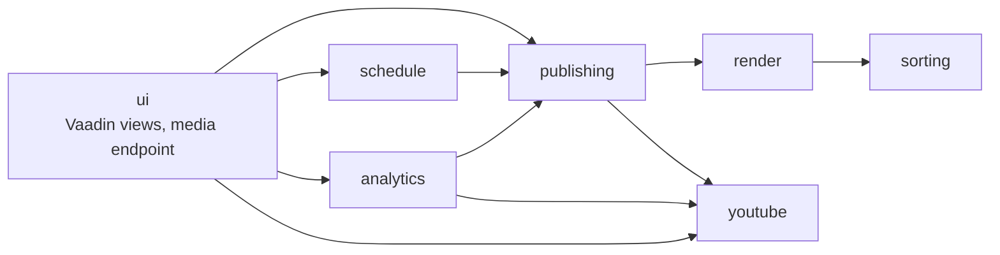

# Shorty

Shorty renders **sorting-algorithm visualization videos** as vertical YouTube Shorts (1080×1920, with a beep per comparison and swap) and **uploads them to YouTube on a schedule**. A small web UI on the home network is used to preview, post, configure and monitor it.

- Algorithms: bubble, quick, merge, insertion and selection sort
- Visual styles, rotated per upload: classic bars, rainbow bars, scatter dots, mirrored bars
- Fixed playback speed (60 steps/s); the bar count is picked so every video stays under 175 s (Shorts limit: 180 s)
- Overlays: algorithm name, live comparison/swap/array-access counters, bar count and Big-O, a final green "sorted" sweep, and a follow card with your channel handle
- Titles, descriptions and tags come from rotating templates (`src/main/resources/application.yml`)
- Screens: **Preview** (test render, plays in the browser) · **Post now** (connect YouTube, publish) · **Schedule** (times of day, time zone, channel handle, visibility) · **History** · **Analytics** (views, likes, comments)

> [!WARNING]
> Shorty has **no login**. Run it on your home network only and never expose port 8080 to the internet.

## Architecture

Java 25 · Spring Boot 4.2 · Vaadin 25 Flow · Spring Modulith 2.2 · Spring Data JPA + PostgreSQL 18 · Flyway · Java2D + ffmpeg · YouTube Data API v3 · Maven · Docker Compose



Each top-level package is a Spring Modulith module with classic layers inside: `view`/`web` → `service` → `repository` → `domain`. `ArchitectureTest` verifies the module boundaries (`ApplicationModules.verify()`) and the layer rules (ArchUnit).

| Module | Responsibility |
|---|---|
| `sorting` | The five algorithms, recording every compare/swap/write as a replayable trace |
| `render` | Bar-count planning, Java2D frames per style, PCM beeps, ffmpeg encoding |
| `youtube` | OAuth connect, AES-GCM-encrypted refresh token, upload, statistics |
| `publishing` | Rotation, templates, upload history, Post now, MP4 retention (newest 20) |
| `schedule` | Times of day and automatic posting |
| `analytics` | Statistics snapshots every 6 h |
| `ui` | Vaadin screens and the `/media/{file}` endpoint for previews |

## Run locally

Prerequisites: JDK 25, Docker, ffmpeg on the `PATH`.

```bash
docker compose up -d          # PostgreSQL on localhost:5432 (compose.yaml)
./mvnw spring-boot:run        # http://localhost:8080
```

Rendering and the UI work without any Google setup. To upload, set the variables from [Configuration](#configuration) (for example in your IDE run configuration) and connect YouTube on the **Post now** screen.

Build and test exactly like CI:

```bash
./mvnw spotless:apply                         # format (CI only checks)
./mvnw test-compile checkstyle:check pmd:check
./mvnw verify                                 # unit + integration tests (Testcontainers, needs Docker) + 80 % coverage gate
```

## Configuration

All secrets come from environment variables; nothing secret is in the repository.

| Variable | Purpose |
|---|---|
| `SHORTY_DB_URL`, `SHORTY_DB_USER`, `SHORTY_DB_PASSWORD` | PostgreSQL connection |
| `SHORTY_ENCRYPTION_KEY` | Base64 32-byte key that encrypts the YouTube refresh token (`openssl rand -base64 32`). Keep a backup |
| `SHORTY_GOOGLE_CLIENT_ID`, `SHORTY_GOOGLE_CLIENT_SECRET` | Google OAuth client |
| `SHORTY_GOOGLE_REDIRECT_URI` | Default `http://localhost:8080/oauth2/callback` |
| `SHORTY_VIDEO_DIR` | Where MP4 files go (`/data/videos` in the container) |
| `TZ` | Container time zone |

## Google / YouTube setup

1. In the [Google Cloud Console](https://console.cloud.google.com/) create a project and enable **YouTube Data API v3**.
2. Configure the **OAuth consent screen** (Google Auth Platform): user type *External*, add yourself as a test user, add the scopes `youtube.upload` and `youtube.readonly`.
3. **Publish the app ("In production").** While it is in *Testing*, refresh tokens expire after 7 days and scheduled uploads stop. You do not need Google's verification for personal use; you will see a "Google hasn't verified this app" warning when connecting. Click *Advanced → Go to …*.
4. Create an **OAuth client ID** of type *Web application* with the authorized redirect URI `http://localhost:8080/oauth2/callback`. Google only accepts plain `http` redirects for `localhost`, not for LAN IPs.
5. Put the client ID and secret into `/opt/shorty/.env` on the server.
6. Open Shorty, go to **Post now → Connect YouTube** and approve.
   - If you opened Shorty as `http://localhost:8080` (on the server itself, or through `ssh -L 8080:localhost:8080 <vm>`), the redirect completes the connection automatically.
   - If you opened it via the VM's LAN address, the browser will fail to load the `localhost` redirect page. Copy that page's full URL from the address bar, paste it into **Redirect URL or code** and click **Finish connecting**.

The refresh token is stored AES-GCM-encrypted in PostgreSQL and survives restarts. If it is revoked, the next upload fails with a clear message in **History** and the **Post now** screen asks you to reconnect.

Quota (checked 2026-11-27): uploads are limited to 100 per day by default, and uploads from unaudited API projects are no longer forced to private.

## Server (home VM) setup

1. Install Docker Engine with the compose plugin, plus `curl`.
2. `sudo mkdir -p /opt/shorty && sudo chown <runner-user> /opt/shorty`, then create `/opt/shorty/.env` from [`deploy/env.example`](deploy/env.example).
3. Register a **self-hosted runner** for this repository (*Settings → Actions → Runners → New self-hosted runner*). Give it the extra label `shorty-deploy` (`./config.sh … --labels shorty-deploy`), install it as a service (`sudo ./svc.sh install && sudo ./svc.sh start`) and add the runner user to the `docker` group.
4. Merge to `main`: CI → image build → Trivy scan → push to GHCR → the runner runs [`deploy/deploy.sh`](deploy/deploy.sh), which pulls the image, starts `app` + `postgres`, waits for `/actuator/health` and rolls back to the previous tag if the new one is not healthy.
5. Open `http://<vm-ip>:8080`.

**Testing the rollback:** in a PR, set `shorty.health.force-down: true` in `application.yml` and merge it. The deploy job fails, the previous image comes back and is healthy. Then revert the change.

### Self-hosted runner safety (public repository)

- Only the `deploy` job uses the self-hosted runner. It runs only from `release.yml`, which is triggered by a successful CI run for a **push to `main`** of this repository. No `pull_request` workflow targets it.
- The `production` environment only accepts the `main` branch, and `main` is protected with required checks.
- Workflows from outside collaborators' fork PRs need approval.
- All actions are pinned to commit SHAs (Dependabot keeps them current). Every workflow declares least-privilege `permissions:`.

## CI/CD

| Workflow | Trigger | What it does |
|---|---|---|
| `ci.yml` (**CI**) | PRs, pushes to `main` | Spotless check → compile with Error Prone → Checkstyle + PMD → unit + integration tests → JaCoCo 80 % lines/branches → SonarQube Cloud scan + quality gate |
| `security.yml` (**CodeQL**, **Dependency Review**, **Trivy**) | PRs, pushes, weekly | CodeQL (security-and-quality), dependency review (fails on high), Trivy filesystem/config scan |
| `release.yml` | CI succeeded on a push to `main` | Vaadin production build → Docker image → Trivy image scan (fails on HIGH/CRITICAL) → push `ghcr.io/pgatzka/shorty:<sha>` → deploy on the VM |
| `dependabot-auto-merge.yml` | Dependabot PRs | Enables auto-merge for patch and minor updates; majors wait for you |

Dependabot (`.github/dependabot.yml`) opens grouped weekly PRs for Maven, GitHub Actions, the Dockerfile and the compose files. Merges done by the auto-merge use the workflow token, and GitHub does not start new workflow runs for those pushes. A Dependabot merge is therefore deployed together with the next merge you make yourself.

### One-time repository setup

- **SonarQube Cloud:** import the repository (organization `pgatzka`, project key `pgatzka_shorty`). Turn off *Automatic Analysis* (CI does the analysis) and create a token. Add it as `SONAR_TOKEN` under *Actions secrets* **and** *Dependabot secrets*. Use a quality gate with ≥ 80 % coverage on new code.
- **Branch protection on `main`:** require PRs and the checks `CI`, `CodeQL`, `Trivy`, `Dependency Review`; allow auto-merge.
- **Environment `production`:** deployment branches limited to `main`.
- **Actions → Fork pull request workflows:** require approval for all outside collaborators.
- **Secret scanning** and **push protection:** on.

## Project status

| Milestone | Status |
|---|---|
| M0 walking skeleton + pipelines | Code done; runner, Sonar and the first deploy need the one-time setup above |
| M1 end-to-end thin slice | Done (bubble sort, overlays, beeps, templates, preview, Post now, OAuth, history) |
| M2 all algorithms, schedule, history, retention | Done |
| M3 visual styles + analytics | Done |
